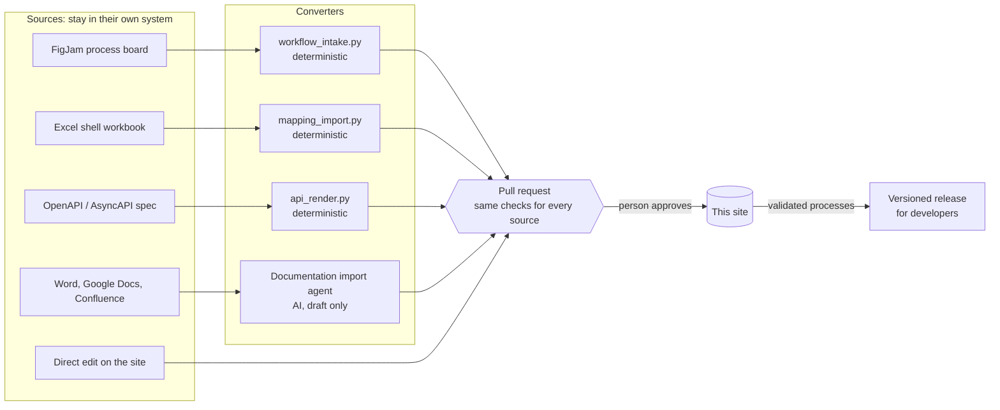

# How content gets in

Documentation arrives from many places: process boards, spreadsheets, API specs, legacy handbooks, and direct edits. Each kind of source has one route into this site. Every route ends in the same place, a pull request that passes the same checks and is approved by a person.

## Routes by source type

| Source | Route | Becomes | Rejected when | Example |
|---|---|---|---|---|
| FigJam process board | `tooling/workflow_intake.py` | Process page, `workflow.yaml`, Gherkin scenarios, computed version | A lint rule fails (R1–R9), with a link to each node on the board | [FO-001](../processes/front-office/FO-001.md) |
| Excel shell workbook | `tooling/mapping_import.py` | Generated tables on a mapping page; narrative kept | A status, rule or gap reference is wrong (M1–M7), or the decision log lacks the entry | [Perfil de huésped](../mapping/perfil-de-huesped.md) |
| OpenAPI / AsyncAPI spec | `tooling/api_render.py` | Searchable API reference; the contract that process bindings are checked against | The page is out of date with the spec (`--check` in CI) | [Front Desk API](../api/front-desk.md) |
| Word, Google Docs, Confluence, Jira | [Documentation import agent](https://github.com/shawndale-glitch/riu-docs-demo/blob/main/.github/agents/documentation-import.agent.md) | Draft pages from the templates, typed (task, concept, reference), with source and `TBC` markers | Never merged without a reviewer; conflicts in the source are listed, not resolved | [Handle a late check-out request](../guides/handle-late-check-out-request.md) |
| Direct edit | **Edit this page** on any page | A pull request | Same checks as everything else | Any page |

## Rules every route follows

- **The source stays where it lives.** Workbooks and Word files don't enter the repository. The page records the file name, version, date and, for structured sources, a SHA-256 hash, so anyone can tell which version a page came from.
- **Structured sources are converted by scripts, not by people or AI.** The same input always gives the same page, and re-running an import changes only what the source changed.
- **AI drafts; people decide.** The import agent writes a `DRAFT` page and lists what it couldn't confirm. It doesn't choose between contradicting sources.
- **One set of checks.** Strict build (broken links, missing navigation), sensitive-data scan, product names and house terms, Markdown lint, and CODEOWNERS approval apply to every pull request, whatever the source.
- **Validation is a person's decision.** A clean import means the input is well formed. Only an SME's approval in the pull request makes it `validated`.

## Related topics

- [Style guide](style-guide.md)
- [Guía para autores: diagramas en FigJam](guia-autores-figjam.md)
- [Decision and gap log](../mapping/decision-log.md)
