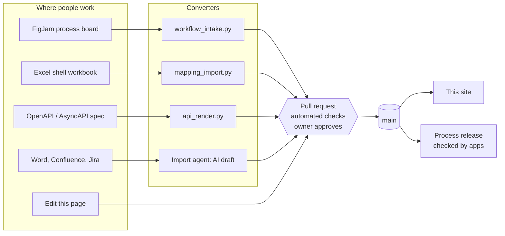

# POC walkthrough

This page explains how the docs-as-code proof of concept (POC) works and why it's built this way. Read it top to bottom once; after that, use it as a map of the repository.

All content on this site is **fictional sample content**. No RIU company data is in the repository, and a check enforces that.

## Guided tour

[Start the self-running tour](#guided-tour){ .md-button .md-button--primary .tour-start }

On the built site, this page starts the tour by itself after a short countdown; choose **Stay on this page** or press **Esc** to read instead. A **Tour** button in the corner of every page starts it again. The tour visits the key pages and explains each one in a caption panel. Press **Space** to pause, the arrow keys to move between stops, and **Esc** to leave. The panel has an **ES / EN** switch.

!!! note "Viewing this file on GitHub?"
    GitHub shows the Markdown source, which can't run the tour. To see it, run `demo\OPEN-TOUR.cmd` (or `OPEN-TOUR-ES.cmd`) from a copy of the repository: it builds the site, serves it locally and opens the tour in the browser.

## What the POC proves

Documentation can be managed like code without asking business authors to learn Git:

- **One place, one version.** Every page is a Markdown file in a Git repository. The site is built from it, so what you read is exactly what was reviewed.
- **Every change is reviewed.** Nothing reaches the site without a pull request, an automated set of checks, and approval by the owner of that content.
- **Sources stay where people work.** Process diagrams stay in FigJam, mappings stay in Excel, API contracts stay in their spec files. Scripts convert them into pages, the same way every time.
- **Developers get something they can test against.** A validated process is released with a version number, and an application can be checked automatically against it.

## The big picture



Read it left to right. Every source has exactly **one route** in, and every route ends in the **same pull request** with the **same checks**. That's the core design decision: one door, one set of rules.

## The logic, layer by layer

### 1. Markdown and MkDocs: the site is built, not edited

| What | Where | Why it matters |
|---|---|---|
| Pages | `docs/` | Plain text: diffable, reviewable, searchable, and owned by no tool vendor |
| Site configuration and menu | `mkdocs.yml` | The `nav` block is the table of contents. A page that isn't in `nav` fails the build. |
| Theme | Material for MkDocs | Search, dark mode, copy buttons, Mermaid diagrams, **Edit this page** |
| Build | `mkdocs build --strict` | `--strict` turns every warning into an error: a broken link or a missing menu entry stops the build |

Because the site is generated, there's no "live page" that someone can change quietly. To change the site, you change the source, and that goes through review.

### 2. One door in: pull requests

| Control | File | What it does |
|---|---|---|
| Branch ruleset | `governance/rulesets/main.json` | Nobody pushes to `main` directly. A change needs an approved pull request and green checks (`build` and `checks`). |
| Code owners | `.github/CODEOWNERS` | Picks the approvers by folder: process SMEs for `workflows/` and `docs/processes/`, engineering for `conformance/`, doc owners for everything else |
| Pull request template | `.github/pull_request_template.md` | Asks what changed and **who validated the content** |
| Status markers | `CONTRIBUTING.md` | `DRAFT` on a page and `TBC` on a fact tell readers what isn't confirmed yet |

The pull request *is* the audit trail: who changed what, why, who approved it, and which checks passed.

### 3. Automated guardrails

The same checks run in three places: on the author's machine before each commit (`.pre-commit-config.yaml`), in GitHub Actions on every pull request (`.github/workflows/quality.yml` and `docs.yml`), and on demand.

| Check | Stops | Rules live in | Script |
|---|---|---|---|
| Strict build | Broken links, pages missing from the menu | `mkdocs.yml` | `mkdocs build --strict` |
| Sensitive data | DNI/NIE, IBAN, card and phone numbers; during the POC also company e-mail domains, classification markers and source files such as `.xlsx` | `governance/sensitive-data.yaml` | `tooling/sensitive_scan.py` |
| Terms | Wrong product names (for example "Opera" instead of "OPERA Cloud") and house vocabulary | `governance/terms.yaml` | `tooling/terms_check.py` |
| Markdown lint | Inconsistent formatting | `.pymarkdown.json` | `pymarkdown` |
| API page in sync | An API reference page that no longer matches its spec | the spec itself | `tooling/api_render.py --check` |
| Pipeline self-test | A rule change that breaks the converters | `examples/library-selftest/` | `tooling/selftest.py` |

The rules are **data, not code**. Adding a forbidden term or a new personal-data pattern is a one-line change to a YAML file, reviewed like any other change.

!!! note "Sensitive-data findings are masked"
    The scan reports the file, line and rule, and masks the value. The report never repeats the data it found.

### 4. Structured sources are converted by scripts, not by hand

| Source | Script | Produces | Example |
|---|---|---|---|
| FigJam process board | `tooling/workflow_intake.py` | `workflow.yaml`, the process page with a Mermaid diagram, Gherkin test scenarios, and a computed version | [FO-001](../processes/front-office/FO-001.md) |
| Excel shell workbook | `tooling/mapping_import.py` | The generated tables of a mapping page | [Perfil de huésped](../mapping/perfil-de-huesped.md) |
| OpenAPI and AsyncAPI specs | `tooling/api_render.py` | The API reference page | [Front Desk API](../api/front-desk.md) |

Three rules make this trustworthy:

1. **Deterministic.** The same input always produces the same output. Re-running an import changes only what the source changed.
2. **Generated blocks are fenced.** Generated content sits between `<!-- generated:start -->` and `<!-- generated:end -->` markers. Scripts rewrite only inside the markers; hand-written explanation around them is kept.
3. **Provenance is recorded.** Each generated page names its source: FigJam file and node, or workbook file, sheet, version and SHA-256 hash. Anyone can tell which version of the source a page came from.

The FigJam intake also **lints** the diagram (rules R1–R9 and W1–W8 in `governance/workflow-rules.yaml`). A placeholder label left on the board, a decision that isn't phrased as a question, or a header version that doesn't match the change is rejected, and the report links straight to the offending shape on the board.

### 5. AI drafts; people decide

Unstructured sources (Word, Confluence, Jira) go through the documentation import agent (`.github/agents/documentation-import.agent.md`). It:

- writes a page from the matching template, marked `DRAFT`;
- records where the content came from;
- marks every unconfirmed fact `TBC` and lists contradictions instead of choosing between them;
- never merges anything. A person reviews the pull request.

See [Handle a late check-out request](../guides/handle-late-check-out-request.md): the agent flagged an outdated source, a missing annex, and a conflict between a policy and a fee table.

### 6. From documentation to developers: versions and conformance

When a process is approved (status `validated`), it's released with a [semantic version](https://semver.org/):

| Change on the board | Version bump | Why |
|---|---|---|
| Wording only | Patch (`0.1.0` → `0.1.1`) | Behavior is unchanged; a person confirms the meaning |
| Something added | Minor | Existing paths still work |
| Something removed, rerouted or reassigned | Major | An application may rely on the old behavior; consumer teams get an issue |

The version is **computed** from a comparison of the old and new model, using the FigJam node IDs as stable identities. Nobody has to remember to bump it.

Application teams then pin a version range and check their app against it:

| Layer | Proves |
|---|---|
| C1 Traceability | Every step on the main path is bound to a real API operation or event |
| C2 Scenarios | The app walks the generated Gherkin scenarios |
| C3 Runtime | Real event traces, grouped by correlation ID, follow the model |
| C4 Manual evidence | Configuration and manual steps were checked and signed off |

Example: `examples/consumer-demo/` binds FO-001 to a fictional front-desk API. The API renamed `checkInGuest` to `checkInReservation`, so C1 fails until the binding is updated. The docs caught a broken integration before testing did.

## Follow one process end to end: FO-001

1. An author draws **early check-in** in FigJam using the Process Design Standards library. See the [guía para autores](../contributing/guia-autores-figjam.md).
2. Intake exports the section, lints it, computes version `0.1.0`, and opens a pull request with `workflows/front-office/FO-001/workflow.yaml`, the page, and `conformance/FO-001/scenarios.feature`.
3. Code owners review. The process SME approves the meaning; the doc owner approves the structure.
4. On merge, the [FO-001 page](../processes/front-office/FO-001.md) appears on the site with its diagram, steps, rules and conformance table.
5. When the SME sets the status to `validated`, the release job tags `FO-001@1.0.0` and publishes the bundle for developers.

## What's real and what's sample

| Item | State in this demo |
|---|---|
| Build, checks, intake, mapping import, API rendering, conformance check | Working; run them yourself (below) |
| Page content | Fictional sample content |
| Publishing to GitHub Pages | Built on every change; publishing is switched off until site hosting is decided |
| Code owner teams | Placeholders until the teams exist in RIU's GitHub organization |
| FigJam REST extraction for CI | Written; not yet run against the live API |
| Home of the repository | A personal account during the POC; moves to RIU's GitHub Enterprise Server. `tooling/repoint_repo.py` and `tooling/ghes_preflight.py` prepare that move. |

## Using it in other areas

Nothing here is specific to front office. A new area needs:

1. A process ID prefix in `governance/areas.yaml` (for example a new prefix for an administration or HR process).
2. A code owner team for its folder in `.github/CODEOWNERS`.
3. A `nav` entry in `mkdocs.yml`.

Spreadsheet-driven documentation works the same way as the RUMBO mapping: the workbook stays authoritative, and a script turns it into reviewed pages. The sensitive-data scan already blocks Spanish personal identifiers and bank account numbers in every phase, not only during the POC.

## Try it yourself

```bash
python -m venv .venv
.venv\Scripts\activate
pip install -r requirements.txt
mkdocs serve
```

Then open <http://127.0.0.1:8000>. The same checks CI runs:

```bash
mkdocs build --strict
python tooling/sensitive_scan.py
python tooling/terms_check.py
python tooling/selftest.py
```

## Words used on this page

| Term | Meaning |
|---|---|
| Docs as code | Writing documentation with the same tools and habits as software: plain-text files, version control, review, automated checks |
| Pull request (PR) | A proposed change, shown as a diff, that others review before it's merged |
| CI | Continuous integration: checks that run automatically on every proposed change |
| `main` | The branch the site is built from |
| Strict build | A build that fails on any warning |
| Generated block | A part of a page written by a script; edit its source, not the page |
| SemVer | Semantic versioning: `major.minor.patch` |
| Conformance | Checking that an application does what the documented process says |

## Related topics

- [How content gets in](../contributing/content-sources.md)
- [Style guide](../contributing/style-guide.md)
- [FO-001: Solicitud de check-in anticipado](../processes/front-office/FO-001.md)
