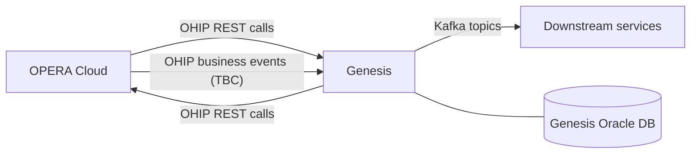

# Genesis and OPERA Cloud integration overview

!!! warning "DRAFT"
    Structure and terminology are in place. Every item marked **TBC** needs confirmation from the Genesis integration team or the OPERA Cloud / OHIP specifications before this page is published as final.

Genesis is the RIU Hotels platform that exchanges guest, reservation, and group data with **Oracle OPERA Cloud**, the property management system (PMS). This page explains the moving parts, which system owns which data, and how records stay linked across systems.

## Systems involved

| System | Role | Interfaces |
|---|---|---|
| **Genesis** | RIU platform; orchestrates guest-centric data and downstream services | Genesis REST APIs, Kafka topics, Oracle Database |
| **OPERA Cloud** | Property management system; system of record for in-property operations | REST APIs and business events via the Oracle Hospitality Integration Platform (OHIP) |
| **Downstream services** | Consumers of Genesis data (TBC: list services) | Kafka topics (TBC) |
| **RUMBO** | RIU legacy platform, being replaced by Genesis and OPERA Cloud; source of the data and configuration migrated to OPERA Cloud | TBC |

## How data flows

Two patterns carry data between the systems:

- **Request/response (REST).** Genesis calls OPERA Cloud APIs through OHIP to read or write business objects such as reservations, profiles, and business blocks.
- **Events.** Changes are propagated as events. Inside Genesis and to downstream services, events travel on Kafka. Whether Genesis consumes OPERA Cloud changes through OHIP business events or by polling is **TBC**.

## Business objects in scope

| Business object | System of record | Notes |
|---|---|---|
| Reservation | OPERA Cloud (TBC) | Genesis stores the OPERA identifiers and its own reference. |
| Guest profile | TBC | Genesis maintains a connected guest identity across stays. |
| Stay | Genesis (TBC) | Genesis concept linking a guest to one or more reservations. |
| Membership | TBC | Loyalty or membership numbers attached to a profile. |
| Business block | OPERA Cloud | Group allotments; individual reservations are picked up from a block. |

## Keeping records linked

Every cross-system link depends on storing the **right identifier** from the **other system**, and on knowing what kind of identifier it is. Genesis must never treat a locator (such as a confirmation number) as if it were the other system's internal ID.

For each business object, the integration records:

1. The **internal ID** issued by the system of record.
2. The **external reference** the other system stored, so each side can find its counterpart.
3. Any **locators** humans use to look up the record.
4. The **correlation ID** of the request or event that created or changed it, for tracing.

See the [identifier glossary](../reference/identifier-glossary.md) for definitions and examples of each type.

## Migration from RUMBO

Data and configuration held in RUMBO move to OPERA Cloud. Each RUMBO building block has a mapping page that shows which OPERA Cloud object it becomes and how each field is carried across. Identifiers that RUMBO issued become **external references** with source system RUMBO wherever they're kept.

See [RUMBO to OPERA Cloud mapping](../mapping/index.md).

## Open questions

- [ ] System of record for guest profiles and memberships
- [ ] OHIP business events vs polling for OPERA Cloud → Genesis changes
- [ ] Kafka topic names, keys, and schemas
- [ ] Which header or field Genesis uses as the correlation ID end to end
- [ ] How UDFs are used, and whether any carry identifiers
- [ ] Whether RUMBO data loads into OPERA Cloud directly or through Genesis
- [ ] Which system is the system of record for each business object while RUMBO and OPERA Cloud run side by side

## Related topics

- [Identifier glossary](../reference/identifier-glossary.md)
- [RUMBO to OPERA Cloud mapping](../mapping/index.md)
- [API reference](../api/index.md)
