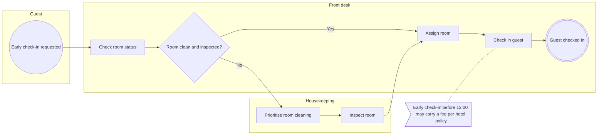

# FO-001: Solicitud de check-in anticipado

!!! warning "DRAFT"
    Status `draft`. This process has not been validated by a business SME. Do not build against it.

<!-- generated:start (tooling/workflow_render.py; edit the FigJam board, not this block) -->

| | |
|---|---|
| Process ID | `FO-001` |
| Version | `0.1.0` |
| Status | draft |
| Owner | Front Office (example) |
| State | as-is |
| Last updated | 2026-10-13 |
| Source | [FigJam section](https://www.figma.com/board/ZKLzn26919OP9YGE3QOk5Z/?node-id=38-468) |
| Machine-readable | [`workflow.yaml`](https://github.com/shawndale-glitch/riu-docs-demo/blob/main/workflows/front-office/FO-001/workflow.yaml) · [changelog](https://github.com/shawndale-glitch/riu-docs-demo/blob/main/workflows/front-office/FO-001/CHANGELOG.md) · [scenarios](https://github.com/shawndale-glitch/riu-docs-demo/blob/main/conformance/FO-001/scenarios.feature) |

## Flow

## Steps

| Step | Lane | Type | Label | Next |
|---|---|---|---|---|
| [`38:511`](https://www.figma.com/board/ZKLzn26919OP9YGE3QOk5Z/?node-id=38-511) | Guest | event.start | Early check-in requested | Check room status |
| [`38:514`](https://www.figma.com/board/ZKLzn26919OP9YGE3QOk5Z/?node-id=38-514) | Front desk | task | Check room status | Room clean and inspected? |
| [`38:516`](https://www.figma.com/board/ZKLzn26919OP9YGE3QOk5Z/?node-id=38-516) | Front desk | gateway.xor | Room clean and inspected? | **Yes** → Assign room; **No** → Prioritise room cleaning |
| [`38:519`](https://www.figma.com/board/ZKLzn26919OP9YGE3QOk5Z/?node-id=38-519) | Front desk | task | Assign room | Check in guest |
| [`38:521`](https://www.figma.com/board/ZKLzn26919OP9YGE3QOk5Z/?node-id=38-521) | Front desk | task | Check in guest | Guest checked in |
| [`38:523`](https://www.figma.com/board/ZKLzn26919OP9YGE3QOk5Z/?node-id=38-523) | Front desk | event.end | Guest checked in | — |
| [`38:526`](https://www.figma.com/board/ZKLzn26919OP9YGE3QOk5Z/?node-id=38-526) | Housekeeping | task | Prioritise room cleaning | Inspect room |
| [`38:528`](https://www.figma.com/board/ZKLzn26919OP9YGE3QOk5Z/?node-id=38-528) | Housekeeping | task | Inspect room | Assign room |

## Business rules

| Rule | Applies to |
|---|---|
| Early check-in before 12:00 may carry a fee per hotel policy | Check in guest |

## Conformance

| Consumer | Version | C1 | C2 | C3 | C4 |
|---|---|---|---|---|---|
| — | — | not verified | not verified | not verified | not verified |

<!-- generated:end -->
