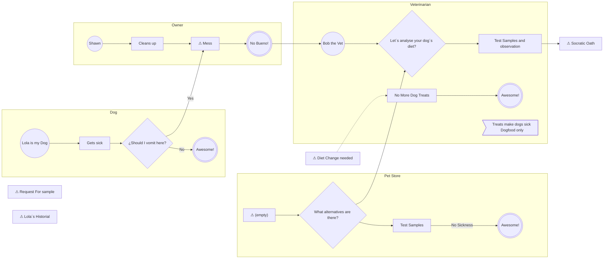

# DOPV-001 — Dieta de mi Perra

> Generated from FigJam. Do not edit by hand; edit the board and re-export.

| Field | Value |
|---|---|
| id | DOPV-001 |
| name | Dieta de mi Perra |
| owner | Shawn |
| version | v0.1 |
| status | Borrador |
| updated | 2026-10-07 |
| state | Actual (as-is) |

## Flow

## Steps

| ID | Lane | Type | Label | Next |
|---|---|---|---|---|
| `18:356` | — | UNTYPED | Socratic Oath | — |
| `18:358` | — | UNTYPED | Diet Change needed | — |
| `18:360` | — | UNTYPED | Request For sample | — |
| `18:364` | — | UNTYPED | Lola´s Historial | — |
| `18:373` | Dog | event.start | Lola is my Dog | Gets sick |
| `18:375` | Dog | task | Gets sick | ¿Should I vomit here? |
| `18:377` | Dog | gateway.xor | ¿Should I vomit here? | [No] Awesome!; [Yes] Mess |
| `18:380` | Dog | event.end | Awesome! | — |
| `18:382` | Owner | event.start | Shawn | Cleans up |
| `18:384` | Owner | task | Cleans up | Mess |
| `18:386` | Pet Store | note | Let´s buy some different food for this dog... she´s got a sensitive tummy. Ask for samples: -option 1 -option 2 -option 3 | — |
| `18:388` | Pet Store | gateway.xor | What alternatives are there? | Test Samples; Let´s analyse your dog´s diet? |
| `18:389` | Owner | event.end | No Bueno! | Bob the Vet |
| `18:391` | Pet Store | task | Test Samples | [No Sickness] Awesome! |
| `18:393` | Pet Store | event.end | Awesome! | — |
| `18:395` | Veterinarian | task | Test Samples and observation | Socratic Oath |
| `18:396` | Veterinarian | event.start | Bob the Vet | Let´s analyse your dog´s diet? |
| `18:398` | Veterinarian | gateway.xor | Let´s analyse your dog´s diet? | Test Samples and observation |
| `18:401` | Veterinarian | task | No More Dog Treats | Awesome! |
| `18:404` | Veterinarian | event.end | Awesome! | — |
| `18:406` | Veterinarian | rule | Treats make dogs sick Dogfood only | — |
| `18:409` | Owner | UNTYPED | Mess | No Bueno! |
| `18:599` | Pet Store | UNTYPED | (empty) | What alternatives are there? |

## Lint

**17 errors, 3 warnings** — export BLOCKED.

- ❌ R2 off-library shape 18:356 (FRAME) «Socratic Oath»
- ❌ R2 off-library shape 18:358 (SHAPE_WITH_TEXT) «Diet Change needed»
- ❌ R2 off-library shape 18:360 (FRAME) «Request For sample»
- ❌ R2 off-library shape 18:364 (SHAPE_WITH_TEXT) «Lola´s Historial»
- ❌ R2 off-library shape 18:409 (SHAPE_WITH_TEXT) «Mess»
- ❌ R2 off-library shape 18:599 (SHAPE_WITH_TEXT) «»
- ❌ R3 connector 18:359 attached to a section/unknown node
- ❌ R3 connector 18:363 attached to a section/unknown node
- ❌ R3 connector 18:365 attached to a section/unknown node
- ❌ R3 connector 18:387 ends on a lane (Pet Store)
- ❌ R4 unlabeled exit 18:559 from gateway.xor 18:388 «What alternatives are there?»
- ❌ R4 unlabeled exit 18:567 from gateway.xor 18:388 «What alternatives are there?»
- ❌ R5 end event has outgoing flow: event.end 18:389 «No Bueno!» → use a message flow (dashed) or an intermediate event
- ❌ R4 XOR with 1 exit(s): gateway.xor 18:398 «Let´s analyse your dog´s diet?»
- ❌ R4 unlabeled exit 18:575 from gateway.xor 18:398 «Let´s analyse your dog´s diet?»
- ❌ R5 unreachable (no incoming flow): task 18:401 «No More Dog Treats»
- ❌ R5 3 start events (expected 1): Lola is my Dog, Shawn, Bob the Vet
- ⚠️ W conditional exit from a non-gateway: task 18:391 «Test Samples» → add an XOR
- ⚠️ W rule 18:406 not linked to any step
- ⚠️ W3 double space in process name
