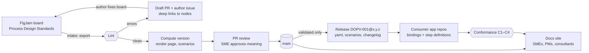
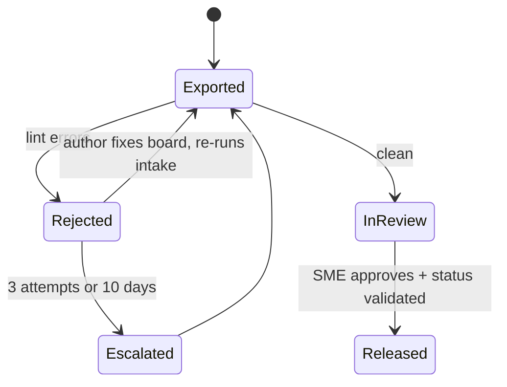

# Workflow pipeline: delivery, versioning, rejection, and conformance

| | |
|---|---|
| Status | Draft for review |
| Owner | Documentation owner (Shawn Dale) |
| Date | 2026-10-13 |
| Machine-readable rules | [`workflow-rules.yaml`](workflow-rules.yaml) (`rules_version: 0.3.1`; rule catalogue under `lint` and `inventory`) |
| Builds on | FigJam export viability study (private repository), PoC export in [`examples/_archive/DOPV-001/`](../examples/_archive/DOPV-001/) (archived) |

This document explains the four rule sets in `workflow-rules.yaml`: what they decide, and why. The YAML is what CI and the [workflow intake agent](../.github/agents/workflow-intake.agent.md) act on. When the two disagree, the YAML wins, and this document is fixed in the same pull request.

The pipeline extends this repository's existing model rather than adding a parallel one:

- Markdown with YAML frontmatter.
- `draft → in-review → validated → deprecated`.
- `DRAFT` and `TBC` markers.
- The numbered decision and gap log.
- PR review as the audit trail.
- The AI drafts; people decide.

## End to end



## 1. Delivery: where each artifact lands, and who can see or change it

### Repository layout (additions to RIU-Documentation)

```text
workflows/
  consumers.yaml                    # which apps implement which process versions
  <area>/<process_id>/
    workflow.yaml                   # source of truth for developers and AI (generated)
    board.json                      # raw FigJam extraction, provenance (generated)
    CHANGELOG.md                    # semantic changelog (generated, append-only notes)
docs/processes/<area>/<process_id>.md   # human page: header, Mermaid flow, steps, rules, conformance badge
conformance/<process_id>/
  scenarios.feature                 # one scenario per path; happy path tagged @happy (generated)
  bindings.yaml                     # node → API operation / event / OPERA config / manual step (developers)
governance/  schemas/  tooling/     # rules, contracts, scripts
```

### Who gets what

| Audience | Gets | Through | Can change |
|---|---|---|---|
| Business SME | Process page, lint findings on their board | Docs site, issue, (optionally) FigJam comments | The FigJam board; approves meaning in the PR |
| PM | Process page, changelog, conformance status | Docs site, release notes | Nothing in the repo; approves release scope |
| Consultant | Process page | Docs site | The FigJam board, if invited |
| Developer / engineer | `workflow.yaml`, scenarios, bindings, changelog | Repo and versioned release bundle | `bindings.yaml`, step definitions in their app repo |
| AI agent | Everything in the repo | Repo | Pull requests only |

### Access: two constraints to settle before go-live

1. **GitHub can't restrict read access per folder.** Anyone with read on the repo reads all of it. CODEOWNERS and branch protection control who *approves changes*, not who *sees*. Content that some audience must not see (commercial terms, for example) goes in a separate repository.
2. **The docs site's visibility depends on the GitHub plan.** GitHub Pages from a private repo can only be restricted to org members on **Enterprise Cloud**. On other plans the published site is public. This needs a decision (D-nnn):
   - (a) Enterprise Cloud with private Pages;
   - (b) host the MkDocs build behind company SSO;
   - (c) share PDFs exported from the site with external consultants.

## 2. Versioning: computed automatically

- **One SemVer line per process** (`DOPV-001@1.4.0`), independent of the schema version (`schema_version`), the rules version (`rules_version`), and the Figma library version.
- **CI computes the bump** from a semantic diff of `workflow.yaml` against the last release, using the Figma node IDs as stable identities:

| Bump | Triggered by | Why |
|---|---|---|
| **Major** | A node, flow, or lane removed; a flow retargeted; a gateway condition changed; a node moved lane or changed type | An implementation may already rely on the old behaviour |
| **Minor** | A node, flow, rule, system, or document added | Existing paths still hold |
| **Patch** | Wording, annotations, notes, header metadata | No behaviour change. A changed label is flagged for a person to confirm the meaning didn't change. |

- **The FigJam header's "Versión" is a check, not the authority.** If it's lower than the computed version, the report shows both values and the author updates the header.
- **Status gates the release.** Header "Estado" maps to the lifecycle: Borrador → `draft`, En revisión → `in-review`, Aprobado → `validated`. Only `validated` versions with zero lint findings are tagged and released. Drafts stay `0.x`.
- **Provenance is written into every export:** Figma file key, page or section, Figma version ID, export time, exporter, library version, and a `content_hash` used for drift detection.
- **Downstream builders pin versions.** Each app declares the range it implements in `workflows/consumers.yaml`. When a version is released:
  - a major opens an issue in each consumer repo;
  - a minor appears in the release notes;
  - a patch notifies no one.
- **Deprecation** reuses `superseded_by` from the topic schema. Old versions stay resolvable for the retention period in the rules file (TBC).

## 3. Rejection: exports that fail validation



- **Nothing fails silently, and nothing invalid reaches `main`.** The last valid version stays published and released.
- **The author gets actionable findings.** An issue goes to the header's "Responsable" (name → GitHub handle in `governance/people.yaml`, TBC). It lists one line per finding, each with a deep link to the exact node on the board. Pinning each finding as a FigJam comment on the node is an option (TBC).
- **The AI fixes only mechanical issues:** whitespace, double spaces, and date format. Everything that changes meaning goes back to the author, because the agent can't know what an unlabelled exit or an unconnected arrow was meant to say.
- **Errors and warnings are treated differently.** Errors block any status. Warnings are tolerated in `draft` but block `in-review` and `validated`.
- **Track the pipeline's health:** first-pass rate, attempts to pass, and the most frequent violations. The most frequent violations feed back into FigJitsu training and the library.

## 4. Conformance: checking the built application against the model

Four layers, from cheapest to most realistic:

| Layer | What it proves | Runs | Blocks the app release? |
|---|---|---|---|
| **C1 Traceability** | Every happy-path task, gateway, and event has a binding. Each binding resolves to a real OpenAPI `operation_id`, AsyncAPI/Kafka event, or OPERA Cloud config item. | Every PR in the app repo | Yes |
| **C2 Scenarios** | The app actually walks the happy path. One Gherkin scenario per start-to-end path is generated from the model; developers write the step definitions. | App CI, against the test environment | Yes (happy path) |
| **C3 Runtime** | Real traces follow the model. Events are grouped by correlation ID and replayed against the model's allowed transitions; any step the model doesn't allow is reported. | Scheduled, on test/UAT logs | No (alert + issue) |
| **C4 Manual evidence** | OPERA Cloud configuration or manual steps that can't be automated were checked | UAT sign-off with role, date, evidence | Yes |

Results are published back to the process page as a conformance badge per version and consumer, with node and flow coverage. That closes the loop for PMs and SMEs without them opening a CI log. A major model change resets the consumer's status to "not verified" for the new version.

**An OPERA-specific caution:** much PMS behaviour is configuration of a vendor product, not Mindata code. Bind those nodes as `opera-config` and verify them through configuration exports where possible, or C4 evidence otherwise. Don't write tests that assume we control OPERA's internal sequence.

C3 depends on two things the integration has to provide:

- a stable correlation ID carried on every event of one business transaction (the identifier glossary already distinguishes correlation IDs from locators);
- readable event logs in a test or UAT environment.

## Decisions needed

Recommendations for each decision, and three more raised by the move to GitHub Enterprise Server, are in the decision brief (private repository).

| # | Decision | Options | Blocks |
|---|---|---|---|
| 1 | Site visibility for SMEs, PMs, and consultants | Enterprise private Pages / SSO-hosted site / PDF export | Go-live |
| 2 | GitHub teams for CODEOWNERS | Create `process-smes`, `engineering`, `doc-owners` | Branch protection |
| 3 | Figma service account and token for CI | One read-only service seat | Automated intake |
| 4 | Controlled list of `area` values (process folders) | Mirror the RIU process map | Folder layout |
| 5 | Deprecation retention period | e.g. 2 majors / 12 months | Release job |
| 6 | Pin lint findings as FigJam comments? | Yes / No | Rejection UX |
| 7 | Production runtime conformance (C3 on production) | Now / after go-live / never | Monitoring scope |

## Implementation order

1. Port the PoC exporter and linter into `tooling/`; add `workflow_version.py` (diff + bump) and `workflow_render.py`.
2. Make DOPV-001 pass lint as the reference process, then release `DOPV-001@1.0.0`.
3. Settle decisions 1–3, enable branch protection, and turn on the intake and release workflows.
4. Generate scenarios; pilot C1 and C2 with one consumer repo.
5. Add C3 once correlation-ID event logs exist in a test environment.
